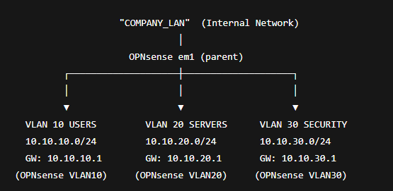

# SIEM + IDS/IPS Lab — OPNsense + Wazuh + Suricata (VirtualBox)

A multi-VM lab that simulates a small company network and runs an end-to-end detection pipeline:

- **OPNsense** as firewall/router and central log source
- **Suricata** on OPNsense for IDS/IPS visibility
- **Wazuh** as SIEM (manager, indexer, dashboard) collecting logs from endpoints and the firewall
- **Kali** as the attacker VM, used to generate traffic and validate detections

---

## What this project covers

### Centralized logging
- Windows endpoint logs via Wazuh agent
- Linux endpoint logs via Wazuh agent (`/var/log/auth.log`)
- OPNsense firewall logs (`filterlog`) via remote syslog
- Suricata events via OPNsense syslog

### Detection & alerting
- Custom Wazuh rules ([`rules/local_rules.xml`](rules/local_rules.xml)) that tag OPNsense syslog, firewall and Suricata events and promote them into `wazuh-alerts-*`
- Investigation in the Wazuh dashboard (Discover, Security events)

### IDS visibility
- Suricata alerts generated from port scans and probing traffic from Kali

---

## Lab architecture

VirtualBox internal network with OPNsense as the gateway for the company LAN:

| VM | Role |
|---|---|
| `OPNsense` | Firewall, Suricata, syslog source |
| `SEC-SRV` | Wazuh server |
| `APP-SRV` | Target server (SSH) |
| `WIN-CLIENT` | Windows endpoint |
| `LINUX-CLIENT` | Linux endpoint |
| `KALI-ATTACKER` | Attack simulation |

Full details (IP plan, log flows, ports): [`docs/architecture.md`](docs/architecture.md)



---

## Tools
- **OPNsense** — routing, firewall rules, DHCP, remote syslog
- **Suricata** — IDS/IPS on OPNsense
- **Wazuh** — SIEM manager, indexer and dashboard
- **Windows Event Logs** and **Linux auth/syslog** via Wazuh agents
- **Kali Linux** — port scans, SSH brute-force simulation

---

## Scenarios tested
- **SSH brute-force** — repeated failed logins from Kali against `APP-SRV`, collected from `auth.log` and searchable in Wazuh
- **Port scan** — Nmap scan from Kali, picked up by Suricata and forwarded to Wazuh through OPNsense syslog

Screenshots for each step: [`docs/evidence.md`](docs/evidence.md)

---

## How to recreate

1. Create the VMs: OPNsense, SEC-SRV, APP-SRV, WIN-CLIENT, LINUX-CLIENT, KALI
2. Build the internal LAN in VirtualBox so all VMs reach OPNsense
3. Configure OPNsense LAN + DHCP for clients, static IPs for SEC-SRV and APP-SRV
4. Install Wazuh all-in-one on SEC-SRV
5. Install Wazuh agents on the Windows and Linux endpoints
6. Point OPNsense remote logging (syslog) to `SEC-SRV:514`
7. Enable Suricata, download rulesets, generate alerts
8. Run the simulations from Kali and check the detections in Wazuh

---

## Repository structure

```
.
├── README.md
├── rules/
│   └── local_rules.xml
├── docs/
│   ├── architecture.md
│   ├── evidence.md
│   └── screenshots/
└── diagrams/
    └── network_diagram.png
```

---

## Known gaps
- Rule tuning is still in progress: less noise, more precise matching.

---

## Disclaimer
For education and lab practice only. All testing was done in an isolated environment on systems I own.
